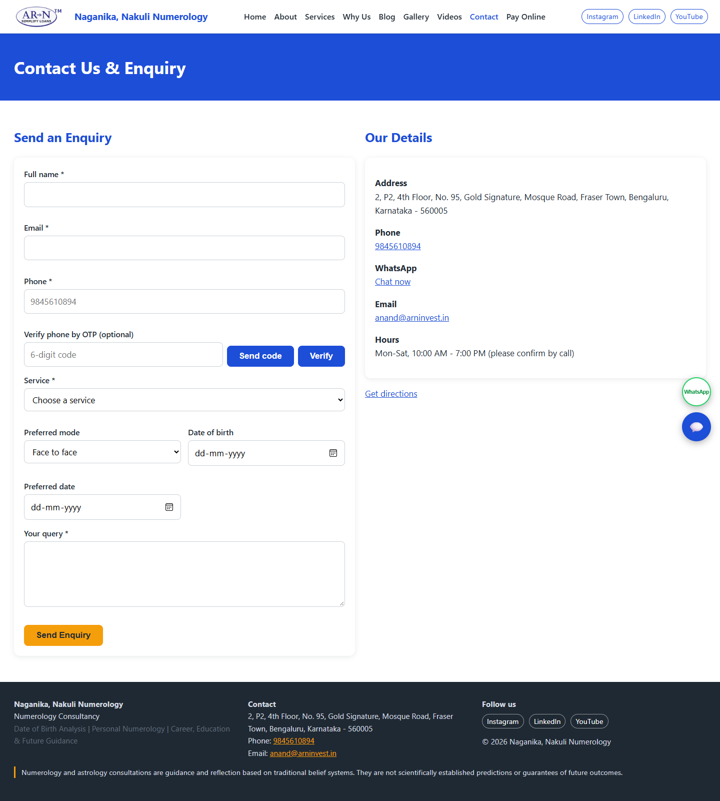
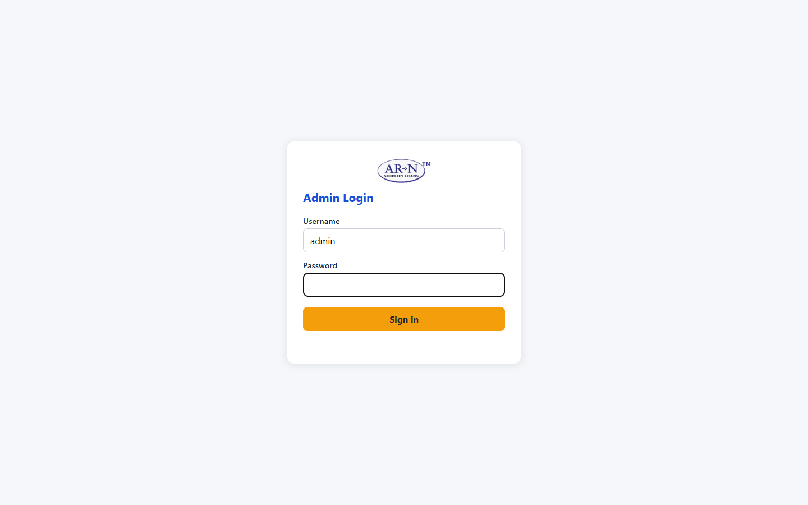
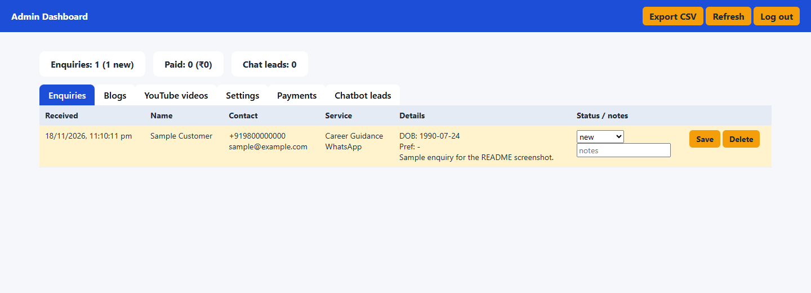

# Naganika, Nakuli Numerology

A full-stack website for a numerology and astrology consultancy in Bengaluru. Visitors can explore services, chat with a guided assistant, send enquiries and pay online. The owner manages everything from a password-protected admin dashboard.


## Features

**For visitors**
- Home, About, Services (12 consultation services), Why Choose Us, Blog, Gallery and Videos pages
- Life Path number calculator
- Enquiry form with validation, spam protection and optional phone OTP verification
- Guided chatbot (problem, solution, service area) that ends with a WhatsApp or enquiry link
- Floating WhatsApp button, Google Map and directions
- Online payment with Razorpay (INR) and a PayPal link for international customers
- YouTube videos and Shorts section with a Subscribe button
- Responsive layout for phones, tablets and desktops

**For the admin (`/admin`)**
- Sign-in page with a signed session cookie
- Enquiries: view, mark as new / contacted / done, add notes, delete, export to CSV
- Blogs: write, edit, hide as a draft, or delete articles
- YouTube videos: paste a YouTube or Shorts link to show it on the site, or remove it
- Settings: edit the YouTube, Instagram and LinkedIn links
- Payments and chatbot leads lists

## Screenshots

| Services | About |
|---|---|
|  |  |

| Why Choose Us | Blog |
|---|---|
|  |  |

| Gallery | Videos |
|---|---|
|  |  |

| Contact | Payment |
|---|---|
|  |  |

**Chatbot**


**Admin**

| Login | Dashboard |
|---|---|
|  |  |

## Tech stack

- **Backend:** Node.js, Express 5
- **Database:** SQLite (Node's built-in `node:sqlite`, no extra setup)
- **Front-end:** plain HTML, CSS and JavaScript (no build step)
- **Email and SMS:** Nodemailer (SMTP) and Twilio, both optional
- **Payments:** Razorpay Orders API with server-side signature verification
- **Deployment:** Dockerfile included

## Getting started

Requires **Node.js 22.13 or newer**.

```bash
git clone https://github.com/Karthikkk07/Naganika-Nakuli-Numerology.git
cd Naganika-Nakuli-Numerology
npm install
cp .env.example .env      # then edit .env (see below)
npm start
```

### Environment variables

Copy `.env.example` to `.env`. Everything is optional except `ADMIN_PASSWORD`, which turns the admin on.

| Variable | Purpose |
|---|---|
| `ADMIN_PASSWORD` | Password for `/admin` (admin is disabled without it) |
| `ADMIN_USER` | Admin username (default `admin`) |
| `PORT` | Server port (default `3000`) |
| `DATA_DIR` | Folder for the SQLite database (default `./data`) |
| `SMTP_*`, `MAIL_FROM`, `ADMIN_EMAIL` | Email alerts for new enquiries |
| `TWILIO_*`, `ADMIN_PHONE` | SMS alerts and OTP verification |
| `RAZORPAY_KEY_ID`, `RAZORPAY_KEY_SECRET` | Enable online payments (use `rzp_test_` keys first) |
| `PAYPAL_ME_LINK` | Show a PayPal button |

Without email, SMS or payment keys the site still works: enquiries are saved to the database and alerts are printed to the server console.

## Customising

- **Logo:** replace `public/img/logo.png`
- **Photos:** photos showing people's faces are not stored in this repository. To show them on your own copy, add `certificate-presentation.jpg`, `ritual-portrait.jpg`, `ritual-group.jpg` and `ritual-fire.jpg` to `public/img/` (the site hides any photo that is missing)
- **Name, phone, WhatsApp, address:** edit the `SITE` block at the top of `public/js/main.js`
- **Services and fees:** edit `public/js/services-data.js`
- **Social links, blogs and videos:** use the admin dashboard

## Project structure

```
server.js          Express app: pages, APIs, admin, payments
db.js              SQLite schema and queries
public/            Website pages, styles, scripts and images
admin/             Admin login and dashboard pages
docs/screenshots/  Images used in this README
Dockerfile         Container build
DEPLOY.md          Deployment guide
```

## Deployment

See [DEPLOY.md](DEPLOY.md). The database is a single SQLite file, so host it where `DATA_DIR` is on a **persistent disk or volume**. Otherwise enquiries are lost whenever the server restarts. Set `ADMIN_PASSWORD` in the host's settings; never commit your `.env` file.

## Security notes

- Input is validated and length-limited on the server; all user text is escaped when displayed
- Per-IP rate limits on enquiries, OTP, payments and admin login
- Honeypot field against form spam
- Razorpay payments are confirmed by verifying the signature on the server
- Admin session cookie is signed, `HttpOnly` and `SameSite=Strict`

## Disclaimer

Numerology and astrology consultations are guidance and reflection based on traditional belief systems. They are not scientifically established predictions or guarantees of future outcomes.
